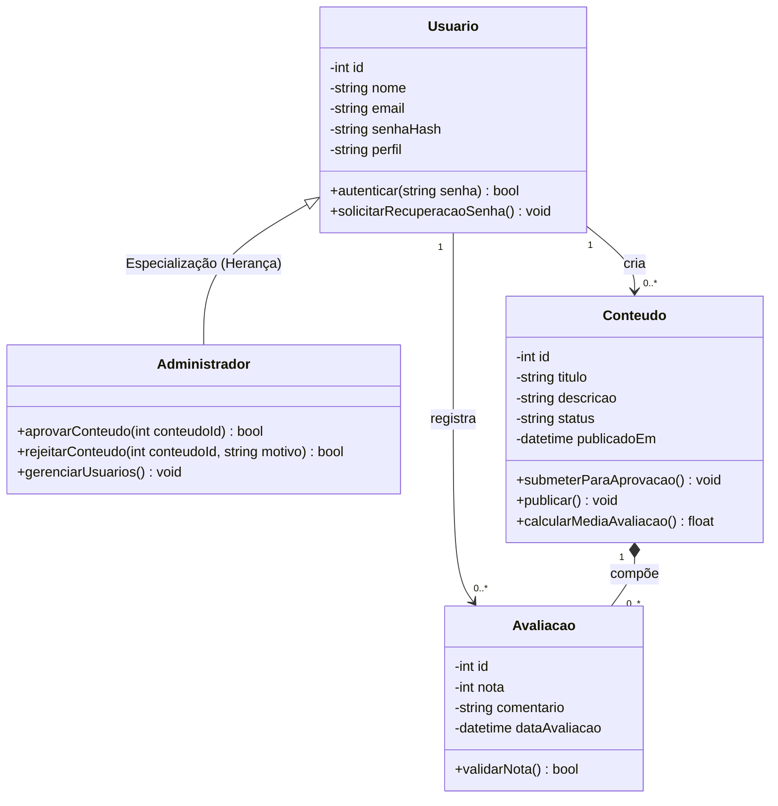

# Exemplo de diagrama de classes de domínio

> Este exemplo é fictício e representa parte de um sistema de publicação de conteúdo. As classes, métodos, herança, associações e multiplicidades não são regras universais; adapte ou remova conforme o domínio, o escopo e a implementação. Um diagrama de classes só deve ser incluído quando ajudar a explicar a solução.

> **Referência no Template Fatec ADS:**
> Exigido no Capítulo 2.5 (*"Diagramas — Caso de Uso, DER, Diagramas de Classes"*). No texto acadêmico, o diagrama deve ser precedido por sua contextualização conceitual e seguido da explicação das principais classes de domínio e suas responsabilidades.

---

### Figura X – Diagrama de Classes de Domínio da Aplicação

<b>Fonte:</b> Autor. (Tamanho 10 no rodapé da figura).

---

### Descrição das Classes e Responsabilidades

- **Classe `Usuario`:** Representa a entidade base de participantes do sistema. Encapsula os dados de identificação e métodos de validação e autenticação.
- **Classe `Administrador`:** Especialização de `Usuario` que herda os atributos de autenticação e acrescenta operações restritas de moderação de conteúdo e gestão de acessos.
- **Classe `Conteudo`:** Representa o recurso informacional publicado. Controla os estados de ciclo de vida (`PENDENTE`, `PUBLICADO`, `REJEITADO`) e a agregação das notas avaliativas.
- **Classe `Avaliacao`:** Representa a avaliação quantitativa e qualitativa fornecida por um usuário a determinado conteúdo.
