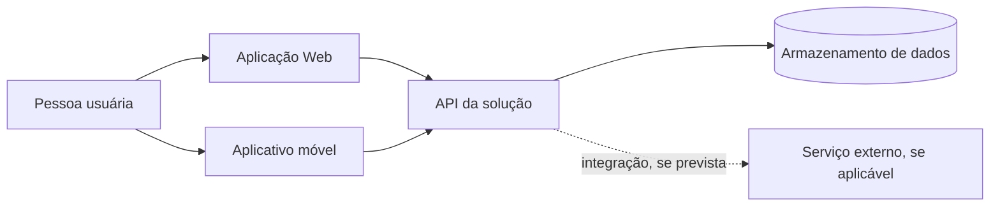

# Visão arquitetural — modelo adaptável

> Use este modelo somente quando uma visão arquitetural ajudar a explicar a solução. Remova componentes que não existam e acrescente os que forem necessários. O exemplo abaixo é fictício; não pressupõe que todo projeto use API, aplicativo móvel, banco relacional, autenticação ou serviços externos.

## 1. Identificação e escopo

- **Projeto e versão:** Projeto Exemplo, versão de planejamento 0.1.
- **Visão apresentada:** contexto e principais componentes.
- **Data:** 2026-10-20.
- **Situação:** proposta, parcialmente implementada ou validada.

## 2. Diagrama

Registre pessoas, sistemas externos, aplicações, serviços, armazenamento e comunicações relevantes ao projeto. Identifique tecnologias somente quando já escolhidas. Em soluções com web e mobile, represente os clientes separadamente quando tiverem responsabilidades ou fluxos distintos.

### Exemplo ilustrativo — web e aplicativo móvel usando uma API

**Legenda do exemplo:** a figura representa apenas uma possibilidade. Se web ou mobile não fizer parte do projeto, retire o elemento. Se o aplicativo funcionar sem conexão, indicar quais operações são locais e como ocorre a sincronização, caso isso esteja definido nos requisitos.

## 3. Componentes e responsabilidades

| Elemento | Responsabilidade no projeto | Tecnologia/ambiente | Situação e evidência |
|---|---|---|---|
| Aplicação Web | Exemplo: oferecer os fluxos previstos para navegador | A confirmar pela equipe | Proposta; decisão ou caminho do código |
| Aplicativo móvel | Exemplo: oferecer os fluxos previstos para celular | A confirmar pela equipe | Incluir somente se aplicável |
| Serviço/API | Exemplo: disponibilizar operações compartilhadas | A confirmar pela equipe | Incluir somente se existir |
| Dados/integrações | Exemplo: persistir ou trocar dados necessários | A confirmar pela equipe | Indicar tecnologia e evidência, se definidas |

## 4. Decisões, relações e limites

Explique comunicações importantes, dependências externas, responsabilidades e decisões que afetam a evolução. Não descreva como existente aquilo que está apenas planejado. Relacione decisões relevantes ao registro em `docs/decisoes/`, quando usado.

**Exemplo fictício:** “A versão demonstrativa prevê que o site e o aplicativo móvel consultem os mesmos dados por um serviço compartilhado. A sincronização quando o dispositivo está sem conexão ainda não foi definida e permanece fora da versão demonstrativa.” Use este texto apenas se corresponder às decisões reais do projeto.

## 5. Evolução das visões

Se usar C4, identifique quais níveis foram elaborados e por quê: contexto (sistema e entorno), contêineres (aplicações e armazenamentos), componentes (partes internas relevantes) e código/classes quando essa visão contribuir para o desenvolvimento. Não é necessário produzir todos os níveis se não forem úteis à solução.

**Exemplo fictício:** “A equipe mantém o contexto e os contêineres porque há site, aplicativo móvel e serviço compartilhado. A visão de componentes será detalhada quando apoiar a implementação do serviço.”

## 6. Referências e evidências

Liste os requisitos, decisões, diagramas detalhados, caminhos do código ou documentos relacionados. Informe a versão/data analisada e marque como proposta, implementada ou validada conforme a evidência disponível.
