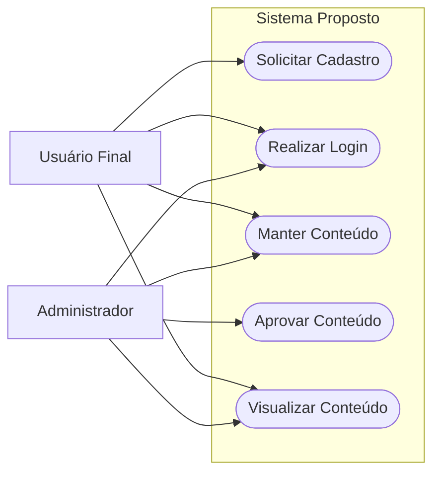

# Exemplo de diagrama de casos de uso conceitual

> O cenário abaixo é fictício (sistema de publicação de conteúdo) e serve apenas para mostrar uma possível representação. Substitua atores e objetivos pelos do projeto real. Não adote cadastro, login, administração ou publicação se esses fluxos não fizerem parte dos requisitos.

> **Referência no Template Fatec ADS:**
> No Capítulo 2.5 (*"Diagramas — Caso de Uso, DER, Diagramas de Classes"*), o template orienta:
> *"Colocar aqui os diagramas mais conceituais... Para o desenvolvimento da ferramenta, foram definidas e declaradas em um diagrama de caso de uso suas funcionalidades... As funcionalidades apresentadas no diagrama são descritas a seguir:"*

---

### Figura X – Diagrama de Casos de Uso Geral

*(Na monografia, utilize fonte tamanho 10 centralizado no título acima da figura).*

<b>Fonte:</b> Autor. (Fonte tamanho 10 no rodapé da figura).

---

### Descrição Sucinta das Funcionalidades do Diagrama

*(Exemplo de redação conforme exigido no template institucional):*

- **Solicitar Cadastro:** Esta funcionalidade permite que usuários que ainda não possuem acesso submetam seus dados básicos para solicitação de cadastro no sistema.
- **Realizar Login:** Permite a autenticação segura de usuários cadastrados (tanto usuários comuns quanto administradores) mediante apresentação de credenciais válidas.
- **Manter Conteúdo:** Disponibiliza operações de inclusão, alteração e consulta de informações pertinentes ao domínio da aplicação por usuários autenticados.
- **Aprovar Conteúdo:** Funcionalidade exclusiva do perfil administrador, permitindo revisar, aprovar ou rejeitar conteúdos submetidos antes de sua publicação geral.
- **Visualizar Conteúdo:** Permite que qualquer usuário que acesse a aplicação consulte as informações públicas homologadas.

> [!NOTE]
> Para um modelo de especificação, consulte [`caso-de-uso-detalhado-template.md`](caso-de-uso-detalhado-template.md). Use-o apenas quando a interação ator-sistema for pertinente e preencha com regras efetivamente documentadas.
