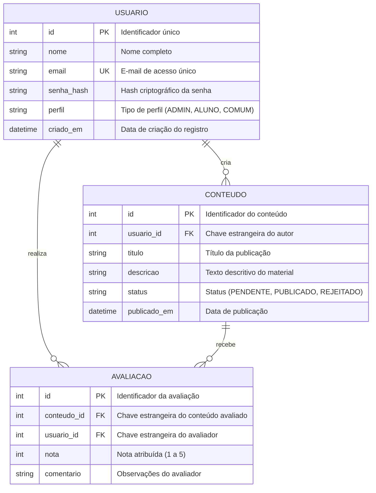

# Modelo de Diagrama de Entidade-Relacionamento (DER)

> **Referência no Template Fatec ADS:**
> Exigido no Capítulo 2.5 (*"Diagramas — Caso de Uso, DER, Diagramas de Classes"*). No texto da monografia, a representação deve seguir o padrão de legendas: título na parte superior (tamanho 10) e fonte na parte inferior (tamanho 10: `Fonte: Autor`).

---

### Figura X – Diagrama de Entidade-Relacionamento (Conceitual / Lógico)

<b>Fonte:</b> Autor. (Tamanho 10 no rodapé da figura).

---

### Descrição dos Relacionamentos

- **USUARIO $\leftrightarrow$ CONTEUDO:** Relação de um para muitos ($1:N$). Um usuário cadastrado pode criar nenhum ou múltiplos conteúdos; cada conteúdo pertence a um único usuário autor.
- **USUARIO $\leftrightarrow$ AVALIACAO:** Relação de um para muitos ($1:N$). Um usuário pode registrar avaliações para múltiplos conteúdos.
- **CONTEUDO $\leftrightarrow$ AVALIACAO:** Relação de um para muitos ($1:N$). Um conteúdo pode receber diversas avaliações de usuários distintos.

> [!TIP]
> Caso a modelagem tenha sido feita em ferramentas como MySQL Workbench, Astah, DBeaver ou Draw.io, salve o arquivo editável nesta pasta (ex.: `der-v1.0.drawio`) e inclua a imagem exportada (`der-v1.0.png`).
